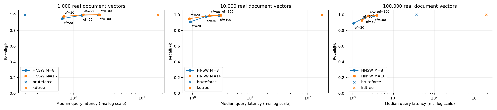

# Measured results

These are measurements from this checkout, not target numbers or simulated timings.

## Search

AG News documents encoded with sentence-transformers/all-MiniLM-L6-v2 (384 dimensions). 100 held-out AG News test documents serve as queries; k=10, cosine distance, seed=42, ef_construction=100. Exact brute-force top-k IDs define recall. Index construction and embedding inference are outside query timing. Three warmups precede each configuration. The brute-force baseline caches its matrix and norms.

| Vectors | Index | M | ef | Recall@10 | Median ms | p95 ms | Build s |
|---:|---|---:|---:|---:|---:|---:|---:|
| 1,000 | bruteforce | — | — | 1.000 | 0.197 | 0.254 | 0.01 |
| 1,000 | kdtree | — | — | 1.000 | 17.003 | 24.935 | 0.01 |
| 1,000 | hnsw | 8 | 20 | 0.951 | 0.691 | 0.870 | 2.71 |
| 1,000 | hnsw | 8 | 50 | 0.993 | 1.337 | 1.571 | 2.71 |
| 1,000 | hnsw | 8 | 100 | 1.000 | 2.324 | 2.713 | 2.71 |
| 1,000 | hnsw | 16 | 20 | 0.979 | 0.721 | 1.167 | 2.40 |
| 1,000 | hnsw | 16 | 50 | 0.998 | 1.390 | 1.783 | 2.40 |
| 1,000 | hnsw | 16 | 100 | 1.000 | 2.397 | 3.079 | 2.40 |
| 10,000 | bruteforce | — | — | 1.000 | 3.000 | 3.899 | 0.11 |
| 10,000 | kdtree | — | — | 1.000 | 176.326 | 207.556 | 0.14 |
| 10,000 | hnsw | 8 | 20 | 0.910 | 0.913 | 1.881 | 44.48 |
| 10,000 | hnsw | 8 | 50 | 0.975 | 1.683 | 2.583 | 44.48 |
| 10,000 | hnsw | 8 | 100 | 0.989 | 2.839 | 5.688 | 44.48 |
| 10,000 | hnsw | 16 | 20 | 0.949 | 0.875 | 1.309 | 46.68 |
| 10,000 | hnsw | 16 | 50 | 0.989 | 1.960 | 3.578 | 46.68 |
| 10,000 | hnsw | 16 | 100 | 0.993 | 3.097 | 4.576 | 46.68 |
| 100,000 | bruteforce | — | — | 1.000 | 36.523 | 40.051 | 0.65 |
| 100,000 | kdtree | — | — | 1.000 | 1878.960 | 2054.988 | 2.44 |
| 100,000 | hnsw | 8 | 20 | 0.891 | 1.047 | 1.651 | 527.01 |
| 100,000 | hnsw | 8 | 50 | 0.964 | 1.972 | 3.881 | 527.01 |
| 100,000 | hnsw | 8 | 100 | 0.989 | 3.215 | 5.125 | 527.01 |
| 100,000 | hnsw | 16 | 20 | 0.929 | 1.669 | 2.650 | 530.59 |
| 100,000 | hnsw | 16 | 50 | 0.985 | 2.445 | 3.743 | 530.59 |
| 100,000 | hnsw | 16 | 100 | 0.992 | 3.901 | 5.450 | 530.59 |



Raw configuration results, mean latency, and compressed snapshot sizes: [benchmark.csv](benchmark.csv). Machine, package, source provenance, and exact run arguments: [benchmark_environment.json](benchmark_environment.json) and [requirements-measured.txt](requirements-measured.txt).

This is a shared host, not a controlled hardware lab. Treat timings as observations; small differences can be noise. KD-tree pruning degrades at 384 dimensions. Python heap, dictionary, and allocation costs can make HNSW slower than vectorized brute force, especially at small N. Larger ef increases work and usually recall; larger M increases graph storage and neighbor work. No universal speedup is claimed.

Graphs were constructed once per size/M. Small graphs used direct insertion; the 100k graphs used the streaming batch builder while encoding continued. Their reported build times sum timed insertions, excluding waits, model inference, and snapshot writes. Final query measurements reuse hash-verified graphs. Snapshot size is disk usage, not peak RAM. The 100k graph needs both original vectors and a normalized cache.

## RAG retrieval

Corpus: 2,067 distinct SQuAD validation paragraphs. Evaluation: 25 questions with human-annotated answers and relevant source IDs. k=3; fixed maximum cosine distance=0.4.

* Filtered HNSW retrieval hit rate: **56%** (14/25).
* Unfiltered exact retrieval hit rate: **76%**.
* Negative-control abstention: **100%** on 3 unrelated questions.

Per-question answers, ground truth, returned IDs/distances, and failures: [rag.json](rag.json). The conservative threshold rejects some valid evidence. It is not a calibrated confidence score. The 25 deterministically selected questions are a small diagnostic set, not a representative quality estimate. SQuAD paragraphs are retrieval units here; the API's overlapping word chunker is separately unit-tested. Retrieval success does not establish answer correctness. Live Groq generation and GitHub CI are confirmed working by the project maintainer. These retrieval metrics do not score generated-answer faithfulness.

## Validation

Recorded correctness run: 33 passed in 1.59s. [pytest.txt](pytest.txt). The API smoke check used 3,000 real AG News documents; restart preserved search results: True. [api_real_smoke.json](api_real_smoke.json).

## Reproduce

```sh
python -m scripts.prepare_data --count 100000
python -m scripts.benchmark --sizes 1000 10000 100000 --m 8 16 --ef 20 50 100 --queries 100
python -m scripts.evaluate_rag
python -m scripts.plot_results
python -m scripts.summarize_results
```

Measured Python 3.14.7, NumPy 2.5.4; BLAS/OMP thread settings are recorded in the environment artifact.
